<div align="center">

# StackScout

**New tech, matched to your stack.**

A weekly tech radar that reads the sources that matter, picks what is relevant to *the tools you actually use*, and compares each new thing with them, with a source link for every claim.

[**Live demo**](https://huynguyenvietwork.github.io/StackScout/) · [Quick start](#quick-start) · [Tiếng Việt](README.vi.md) · [**Want it hosted? Join the waitlist**](../../issues/new?template=hosted_waitlist.yml)

 

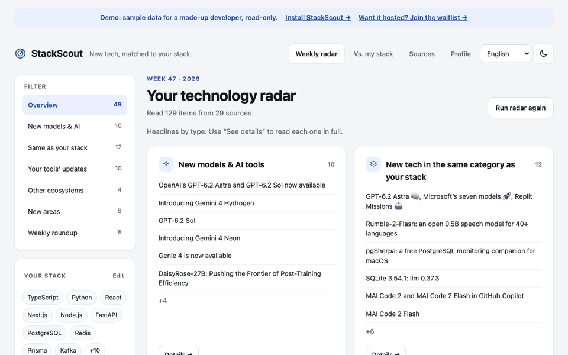

</div>

## Why

Keeping up is a part-time job: new models every week, new libraries, release notes, benchmarks that disagree. Most newsletters list *everything*. StackScout starts from **your stack** and answers one question per item: *should I care, and how does it compare with what I use today?*

## Features

### 📡 Your week at a glance

One page with the headlines of the week, grouped by what they mean for you: new AI models and tools, new tech of the same kind as your stack, updates to tools you already use, other ecosystems, new areas, and a roundup. Click **Details** to read each group in full.

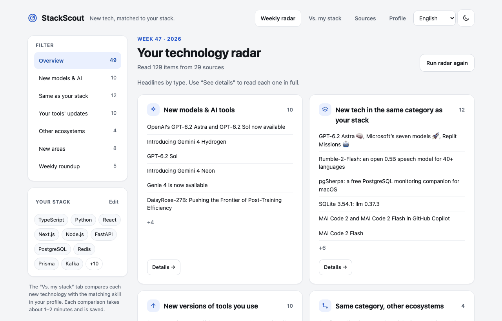

### 🤖 New AI models, compared with their strongest rivals

Straight from first-party channels (Anthropic, OpenAI, Google DeepMind, Gemini, Hugging Face…). Click a model and StackScout has already looked up its **3–5 strongest competitors**: what it does better, what it does worse, and which one to pick, with benchmark numbers, prices and a link behind every line.

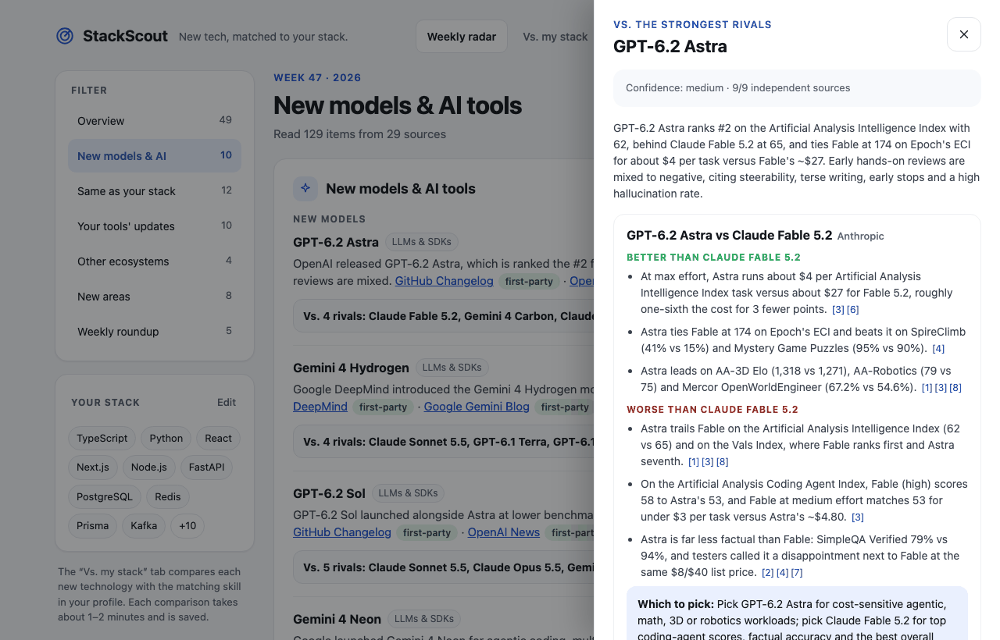

### 🧩 Compared with your stack, automatically

Every new technology of the same kind as one of your tools is compared with that tool right after the radar runs, grouped by your skills. Each one gets a verdict, **adopt, trial, watch or skip**, plus what fits you and what doesn't. Use **⋯** to compare it with any other tool in your profile.

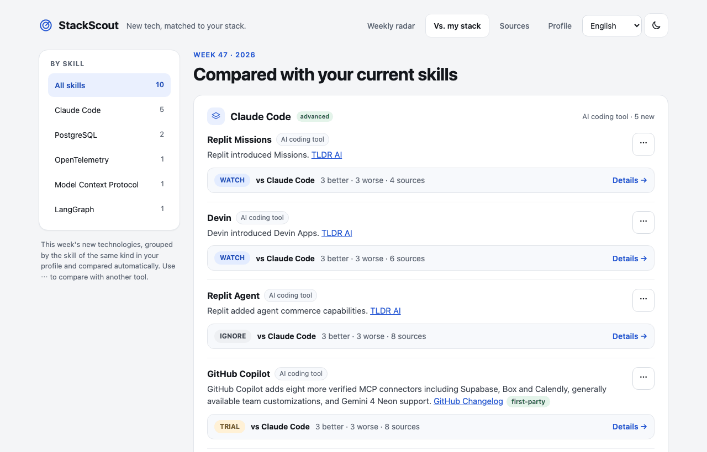

### 🔗 Every claim has a source

Each comparison shows the verdict and how confident it is, a short *for you* note based on your stack, what is new, at most 3 pros and 3 cons, and the numbered sources behind them. Rules enforced in code, not left to the AI:

- a pro or con without a valid link is dropped;
- fewer than 2 sources means *"not enough data yet"*;
- independent benchmarks and hands-on reports are preferred and labelled; with no independent source, confidence can't be *high*.

<table>
<tr>
<td width="50%">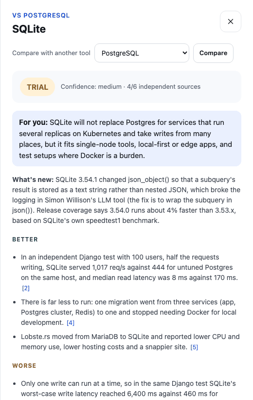</td>
<td width="50%">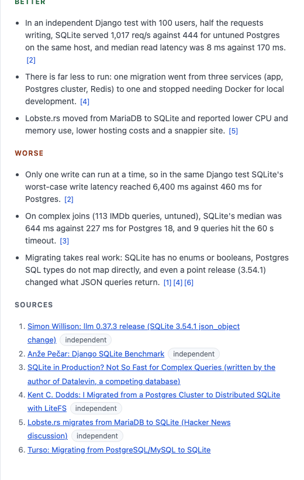</td>
</tr>
</table>

### 📬 The digest, where you read

Every week, in your language, on any of: **Telegram, email, Slack, Discord**, or any **webhook** (n8n, Zapier, Make…). Under each item: the verdict against your tool, or the rivals of a new model.

<table>
<tr>
<td width="50%"><b>Email</b><br>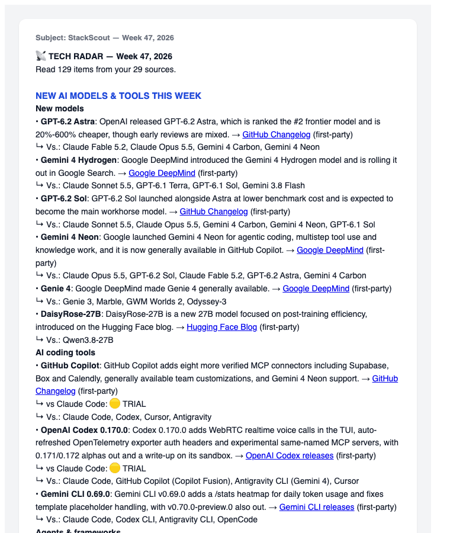</td>
<td width="50%"><b>Telegram</b><br>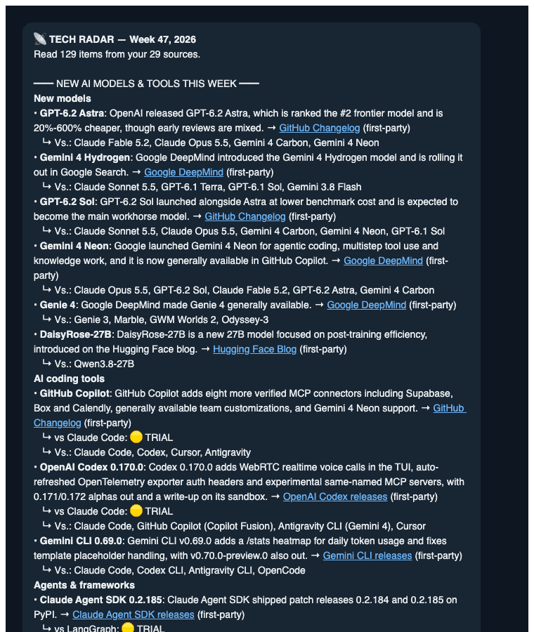</td>
</tr>
</table>

### 👤 Your profile in your own words, private by design

Type what you use, typos and all (*"c#, entity framwork, postgres, k8s"*), or generate it from your code or CV with the included prompt. AI turns it into canonical names and levels; you confirm before anything is saved. **Only technology names and levels are stored**: no project names, no employer, nothing about your work.

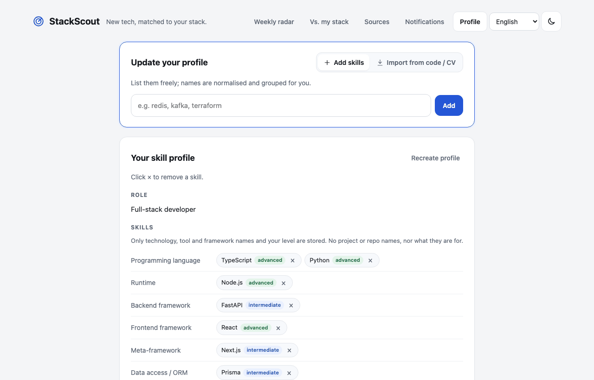

### 📰 Sources that matter, picked for your stack

About 60 curated, live feeds. First-party AI channels are always on, the official blogs and release feeds of *your* technologies switch on by themselves, and community sources (Hacker News, trending GitHub repos, Lobsters…) are one click away. Add any blog, RSS feed or GitHub repo.

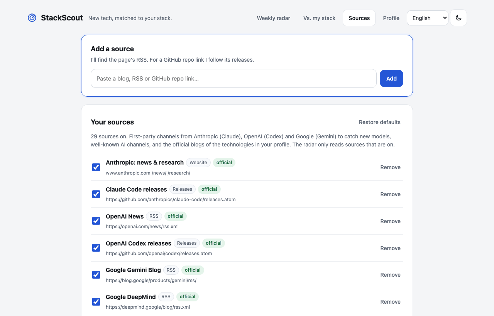

### 🌏 5 languages, light and dark, on your phone

English, Tiếng Việt, 中文, 日本語, 한국어: the interface, the AI-written summaries and comparisons, the digests and the Telegram bot.

<table>
<tr>
<td width="40%">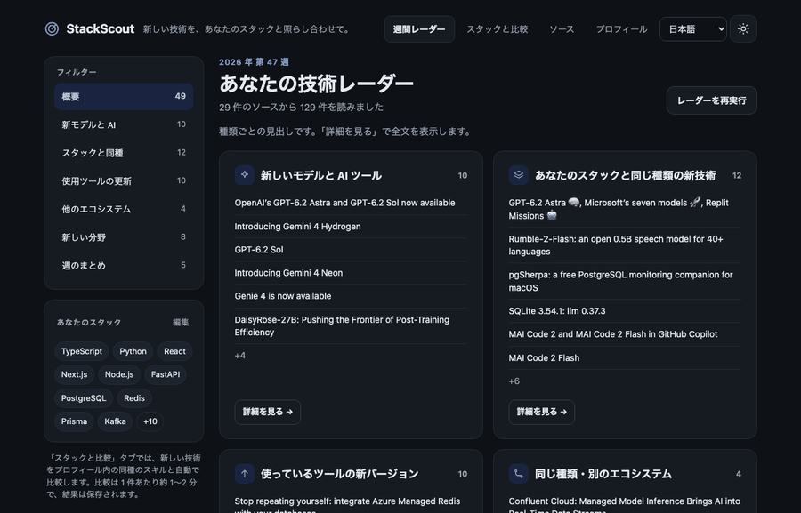</td>
<td width="40%">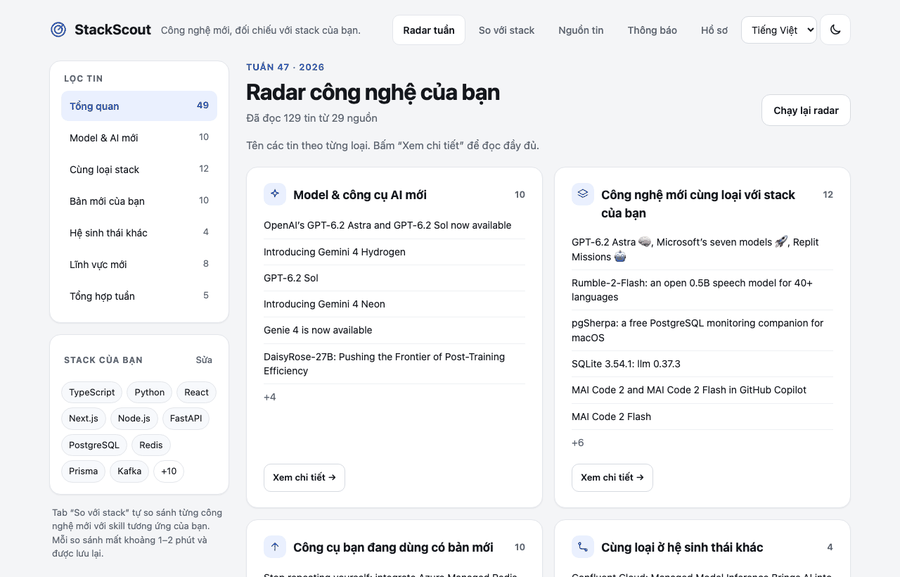</td>
<td width="20%">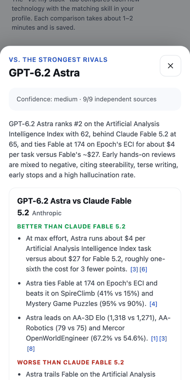</td>
</tr>
</table>

## How it works

1. **Profile**: your technologies and levels, normalised to a fixed taxonomy.
2. **Collect**: the week's items from your sources (RSS/Atom, release feeds, Hacker News, GitHub, sitemaps), deduplicated across weeks.
3. **Classify** with AI into the same taxonomy, then **match in plain Python**:

   | Match | What you get |
   |---|---|
   | New version of a tool you use | Short changelog line |
   | **Same category, same ecosystem** | **Automatic comparison with your tool** |
   | Same category, other ecosystem | Reference note |
   | New model or AI tool | **Comparison with its strongest competitors** |
   | Category you don't have yet | "Worth a look" |

4. **Compare** with web search, then enforce the source rules in code; **deliver** on your channels.

## Quick start

You need an AI backend: an **Anthropic API key**, or the [Claude Code](https://code.claude.com) CLI already logged in (any CLI that reads a prompt on stdin works through `STACKSCOUT_AI_CMD`).

### Docker

```bash
git clone https://github.com/huynguyenvietwork/StackScout && cd StackScout
cp .env.example .env          # set ANTHROPIC_API_KEY, and a notification channel if you want one
docker compose up -d          # web UI on http://127.0.0.1:8000 + weekly digest (Monday 08:00)
docker compose --profile bot up -d   # optional: the Telegram bot too
```

### uv

```bash
git clone https://github.com/huynguyenvietwork/StackScout && cd StackScout
uv sync                       # Python 3.11+, https://docs.astral.sh/uv/
cp .env.example .env          # ANTHROPIC_API_KEY, or leave it empty to use the `claude` CLI
uv run main.py web            # http://127.0.0.1:8000
```

Create your profile in the browser (about 2 minutes), press **Run this week's radar** (2–3 minutes), and comparisons fill in on their own over the next minutes.

> The web UI has **no login** and listens on 127.0.0.1 only. Don't expose it to a network without authentication in front of it.

## Notifications

The digest goes out every week, in your language, on every channel configured in `.env`:

| Channel | Settings |
|---|---|
| Telegram | `TELEGRAM_BOT_TOKEN` (from @BotFather), `STACKSCOUT_TELEGRAM_CHAT_ID` (your user id) |
| Email | `SMTP_HOST`, `SMTP_PORT`, `SMTP_USER`, `SMTP_PASSWORD`, `SMTP_FROM`, `STACKSCOUT_EMAIL_TO` |
| Slack | `STACKSCOUT_SLACK_WEBHOOK_URL` (incoming webhook) |
| Discord | `STACKSCOUT_DISCORD_WEBHOOK_URL` |
| Anything else | `STACKSCOUT_WEBHOOK_URL`: the digest as JSON (n8n, Zapier, Make, ntfy…) |

The **Sources** tab shows which channels are on and can send the latest digest as a test. Scheduling: Docker runs `main.py schedule` (`STACKSCOUT_DIGEST_DAY`, `STACKSCOUT_DIGEST_TIME`); without Docker, use cron:

```bash
0 8 * * 1 cd /path/to/stackscout && /path/to/uv run main.py digest >> reports/cron.log 2>&1
```

## Telegram bot

`uv run main.py bot` (set `TELEGRAM_BOT_TOKEN` and `STACKSCOUT_ALLOWED_USERS` first: every request costs an AI call on your account). The bot follows your Telegram language; change it with `/language`.

| Command | What it does |
|---|---|
| `/start` | Create your profile |
| `/profile`, `/add redis, kafka`, `/remove` | View and edit your skills |
| `/sources`, `/addsource <link>`, `/reset` | Manage sources |
| `/radar` | Build this week's radar now |
| send a `.yaml` file | Import a profile generated from your code or CV |
| `/language`, `/cancel` | Change language, abort the current step |

## Privacy

- Your profile stores **technology names and levels only**. Project names, repos, what they are for and anything about your employer are dropped on save and on import; URLs, emails, IPs, hostnames and secret-looking strings are scrubbed from free text.
- Secrets (API key, bot token, SMTP password, webhook URLs) live in `.env` and never go through the browser.
- Every AI step runs without tools, except comparisons, which get web search and fetch only. Your profile is never put in a search query.
- Data stays on your machine: `data/` (profiles, sources, comparisons) and `reports/` are plain files.

## Project layout

```
config/                  taxonomy and the curated source catalog
prompts/                 every prompt, kept out of code so they are easy to tune
stackscout/ai.py         AI backends: Anthropic API or a headless CLI
stackscout/profile.py    normalise, validate, merge, import profiles
stackscout/sources.py    per-user sources, feed discovery, SSRF guard
stackscout/collect.py    RSS / Hacker News / GitHub / sitemap fetchers, dedupe
stackscout/classify.py   AI classification + Python matching
stackscout/compare.py    sourced comparisons (your stack, market rivals), rule enforcement
stackscout/digest.py     the weekly pipeline, comparison caches, report files
stackscout/render.py     the digest for each channel, in each language
stackscout/notify.py     Telegram, email, Slack, Discord, webhook delivery
stackscout/i18n.py       server-side messages in 5 languages
stackscout/web.py        local web UI + API;  stackscout/static/index.html
stackscout/bot.py        Telegram bot (texts in bot_text.py)
main.py                  web | bot | digest | schedule
scripts/build_demo.py    builds the read-only demo in docs/
```

## Contributing

Ideas, sources, languages and channels are all welcome: see [CONTRIBUTING.md](CONTRIBUTING.md). Run the tests with `uv run pytest -q` (offline, no AI calls). Security issues: [SECURITY.md](SECURITY.md).

**Would you use a hosted version** (no install, no API key)? [Tell us here](../../issues/new?template=hosted_waitlist.yml): it decides whether we build it.

## License

[MIT](LICENSE)
