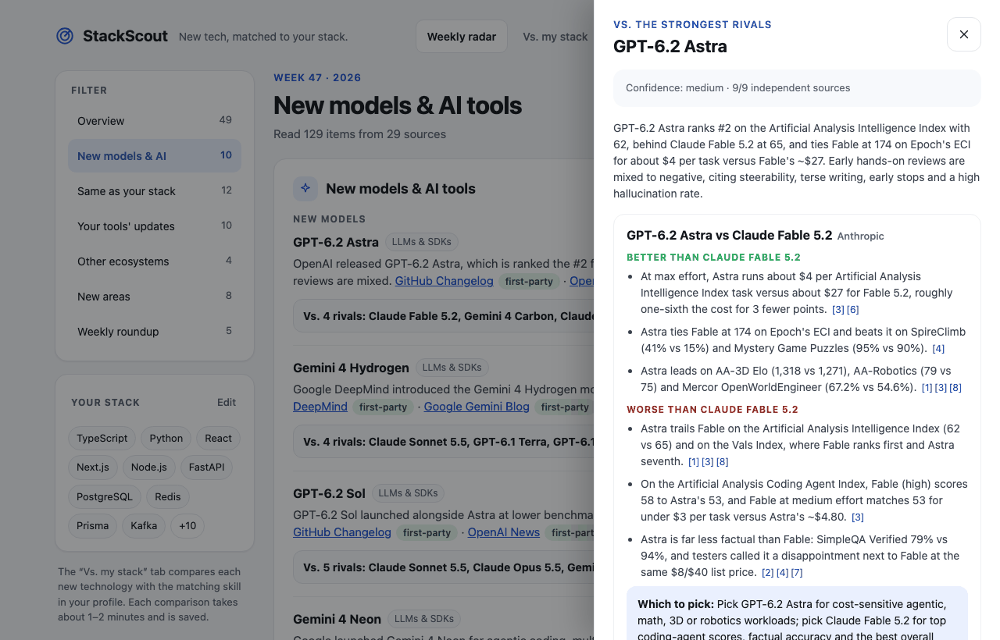
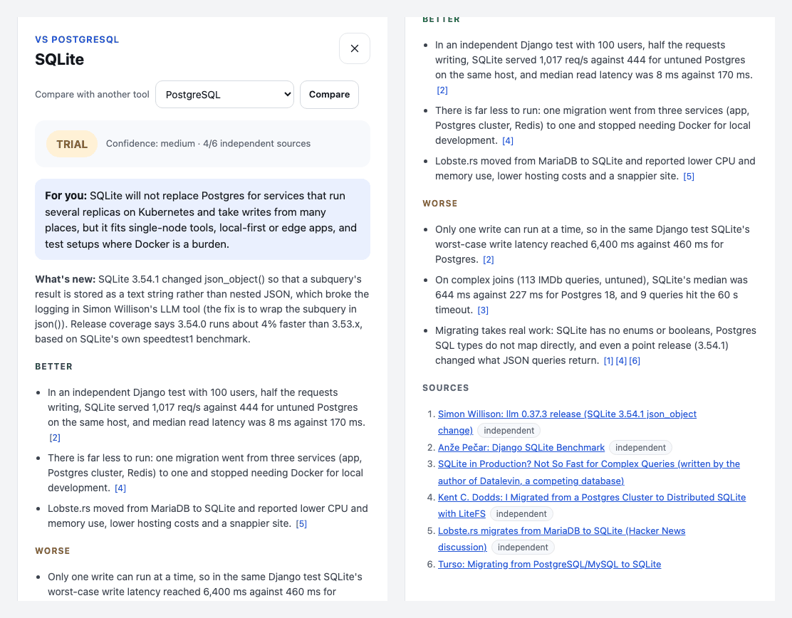
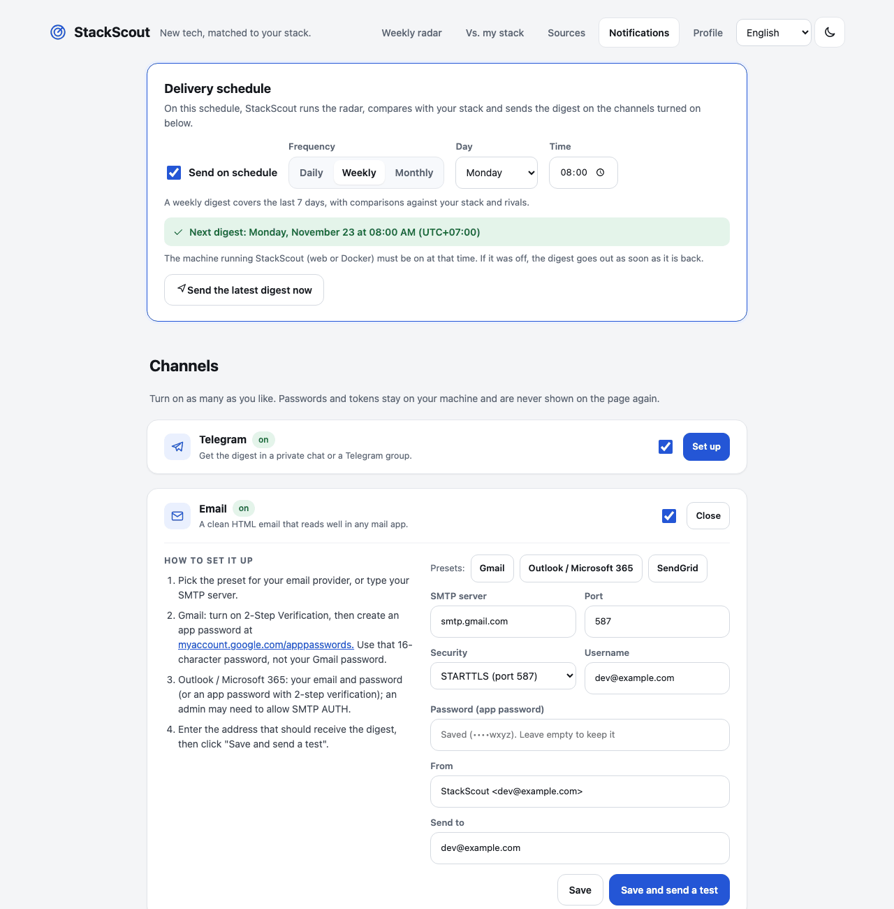
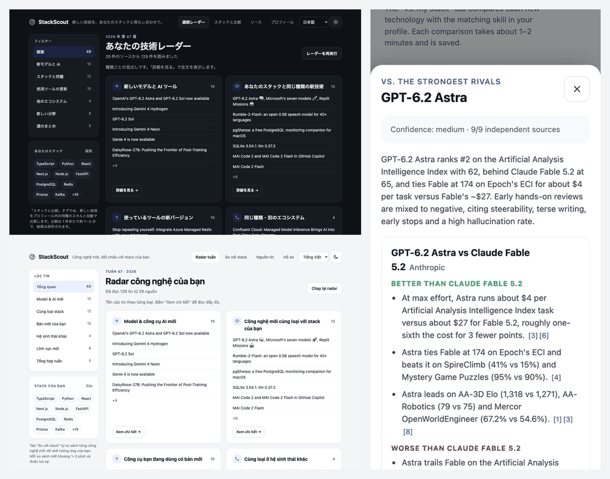

# StackScout (Tiếng Việt)

**Công nghệ mới, đối chiếu với stack của bạn.** · [English](README.md) · [Xem demo](https://huynguyenvietwork.github.io/StackScout/) · [**Tải về**](https://github.com/huynguyenvietwork/StackScout/releases/latest)

[](https://github.com/huynguyenvietwork/StackScout/releases/latest)

StackScout là radar công nghệ hằng tuần: đọc các nguồn chính chủ và uy tín, chọn ra tin liên quan tới **đúng những công cụ bạn đang dùng**, rồi tự so sánh từng công nghệ mới với chúng. Mọi nhận định đều có link nguồn.


## Chạy thử

> **Phạm vi:** StackScout hiện được thiết kế để tự host cho cá nhân. Web UI phục vụ một hồ sơ local và không có đăng nhập (chỉ nghe trên 127.0.0.1, đừng mở ra mạng nếu không có lớp xác thực phía trước). Phiên bản hosted chính thức có thể được phát triển sau.

Cần một trong hai: **API key Anthropic**, hoặc **Claude Code CLI** đã đăng nhập (chỉ dùng được khi chạy bằng uv, không dùng được trong Docker). Xem [chi phí](README.md#what-it-costs).

### 🤖 Cài bằng trợ lý AI

Dùng Claude Code, Cursor hay Codex? Dán câu này vào:

```text
Cài StackScout giúp tôi từ https://github.com/huynguyenvietwork/StackScout: clone về, làm theo AGENTS.md, chạy `main.py doctor` tới khi không còn ❌, rồi mở giao diện web. Khi cần API key hay token, hãy bảo tôi tự nhập trong terminal của tôi, không hỏi trong chat.
```

AI sẽ tự kiểm tra máy, cài phần còn thiếu rồi mở trang web. Key do bạn tự nhập, không đi qua khung chat.

### Docker, image dựng sẵn (không cần clone)

```bash
read -rsp "Anthropic API key: " ANTHROPIC_API_KEY && export ANTHROPIC_API_KEY   # gõ ẩn, không lưu vào lịch sử
docker run -d --name stackscout --restart unless-stopped -p 127.0.0.1:8000:8000 -e ANTHROPIC_API_KEY \
  -v stackscout_data:/app/data -v stackscout_reports:/app/reports ghcr.io/huynguyenvietwork/stackscout
```

Mở http://127.0.0.1:8000. Kiểm tra: `docker exec stackscout uv run --no-sync main.py doctor --online`.

### uv (dùng được cả Claude Code CLI)

```bash
git clone https://github.com/huynguyenvietwork/StackScout && cd StackScout   # hoặc: giải nén bản tải về rồi cd vào
uv sync
uv run main.py setup     # tạo .env, hỏi API key (gõ ẩn) hoặc dùng Claude Code CLI, rồi tự kiểm tra
uv run main.py web       # mở http://127.0.0.1:8000
```

Không có git: [tải bản phát hành mới nhất](https://github.com/huynguyenvietwork/StackScout/releases/latest) (mục *Assets* → **Source code (zip)**), giải nén rồi mở terminal trong thư mục đó. Gặp lỗi: `uv run main.py doctor` liệt kê phần còn thiếu và cách sửa. Docker Compose, kênh thông báo, bot Telegram, lịch gửi: xem [README.md](README.md).

## Tính năng chính

<table>
<tr>
<td width="29%" valign="top">

### 📡 Cả tuần trong một màn hình

Tiêu đề tin trong tuần, chia theo ý nghĩa với bạn:

- Model & công cụ AI mới
- Công nghệ mới cùng loại với stack của bạn
- Bản mới của công cụ bạn đang dùng
- Hệ sinh thái khác, lĩnh vực mới, tổng hợp tuần

Bấm **Xem chi tiết** để đọc đầy đủ từng loại.

</td>
<td width="71%" valign="top"><a href="docs/assets/overview.png"></a></td>
</tr>
<tr>
<td width="29%" valign="top">

### 🤖 Model AI mới so với đối thủ mạnh nhất

Tin lấy thẳng từ kênh chính chủ: Anthropic, OpenAI, Google DeepMind, Gemini, Hugging Face…

Bấm vào một model để mở trang riêng so sánh với **3–5 đối thủ mạnh nhất**, đã tìm sẵn:

- bảng tổng quan các đối thủ, rồi từng phần chi tiết cho mỗi đối thủ
- số liệu đặt cạnh nhau (benchmark, giá, context window…)
- hơn gì, kém gì, nên chọn khi nào, mỗi ý đều có link

</td>
<td width="71%" valign="top"><a href="docs/assets/rivals.png"></a></td>
</tr>
<tr>
<td width="29%" valign="top">

### 🧩 Tự so sánh với stack của bạn

Ngay sau khi radar chạy, công nghệ mới cùng loại với công cụ bạn dùng được tự so sánh và chia theo từng skill.

- kết luận: **nên chuyển, thử nghiệm, theo dõi hay bỏ qua**
- **Xem chi tiết** mở trang riêng toàn màn hình; Back quay lại đúng chỗ đang đọc
- **⋯** để so với công cụ khác trong hồ sơ

</td>
<td width="71%" valign="top"><a href="docs/assets/vs-stack.png"></a></td>
</tr>
<tr>
<td width="29%" valign="top">

### 🔗 Nhận định nào cũng có nguồn

Mỗi so sánh có trang riêng: kết luận và độ tin cậy, nhận xét *với bạn*, điểm mới, **bảng số liệu đặt cạnh nhau**, tối đa 5 hơn và 5 kém, **mức độ khó khi chuyển đổi**, kèm danh sách nguồn đánh số.

Kiểm tra bằng code, không phó mặc cho AI:

- ý không có link hợp lệ bị bỏ
- dưới 2 nguồn → *"chưa đủ dữ liệu"*
- ưu tiên benchmark độc lập, có gắn nhãn

</td>
<td width="71%" valign="top"><a href="docs/assets/claims.png"></a></td>
</tr>
<tr>
<td width="29%" valign="top">

### 📬 Bản tin gửi tới nơi bạn đọc

Mỗi tuần, đúng ngôn ngữ của bạn, qua:

- **Telegram**
- **Email**
- **Slack** và **Discord**
- **webhook** bất kỳ (n8n, Zapier, Make…)

Dưới mỗi tin: kết luận so với công cụ của bạn, hoặc các đối thủ của model mới.

</td>
<td width="71%" valign="top"><a href="docs/assets/digests.png"></a></td>
</tr>
<tr>
<td width="29%" valign="top">

### 🔔 Thông báo, cài trong vài phút

Một tab riêng: gửi **hằng ngày, hằng tuần hoặc hằng tháng** vào giờ bạn chọn, rồi bật kênh muốn nhận.

- hướng dẫn từng bước cho mỗi kênh (BotFather, App Password của Gmail, webhook Slack và Discord…)
- mẫu sẵn cho Gmail, Outlook, SendGrid; nút **Tìm chat ID** cho Telegram
- **Lưu và gửi thử**, kèm nhật ký gửi
- mật khẩu và token chỉ lưu trên máy bạn, không hiện lại

</td>
<td width="71%" valign="top"><a href="docs/assets/notifications.png"></a></td>
</tr>
<tr>
<td width="29%" valign="top">

### 👤 Hồ sơ gõ tự nhiên

Cứ gõ những gì bạn dùng, sai chính tả cũng được (*"c#, entity framwork, postgres, k8s"*), hoặc tạo từ code hay CV bằng prompt có sẵn.

- AI chuẩn hoá tên và mức độ, bạn xác nhận rồi mới lưu
- **bảo mật từ thiết kế**: chỉ lưu tên công nghệ và mức độ, không lưu gì về dự án hay công ty

</td>
<td width="71%" valign="top"><a href="docs/assets/profile.png"></a></td>
</tr>
<tr>
<td width="29%" valign="top">

### 📰 Nguồn tin chất lượng, theo stack

Khoảng 60 nguồn đã chọn lọc và kiểm tra.

- kênh AI chính chủ: luôn bật
- blog và trang phát hành chính thức của công nghệ *bạn dùng*: tự bật
- nguồn cộng đồng (Hacker News, repo GitHub mới nổi…): một cú bấm
- thêm bất kỳ blog, RSS hay repo GitHub nào

</td>
<td width="71%" valign="top"><a href="docs/assets/sources.png"></a></td>
</tr>
<tr>
<td width="29%" valign="top">

### 🌏 5 ngôn ngữ, sáng/tối, trên điện thoại

Tiếng Việt, English, 中文, 日本語, 한국어 cho giao diện, nội dung AI viết, bản tin và bot Telegram.

Có giao diện sáng và tối; trên điện thoại, so sánh mở dạng khung trượt từ dưới lên.

</td>
<td width="71%" valign="top"><a href="docs/assets/looks.png"></a></td>
</tr>
</table>

Muốn dùng **bản online không cần cài đặt**? [Đăng ký ở đây](../../issues/new?template=hosted_waitlist.yml), số người đăng ký sẽ quyết định có làm hay không. Góp ý, thêm nguồn tin, thêm ngôn ngữ: xem [CONTRIBUTING.md](CONTRIBUTING.md).
