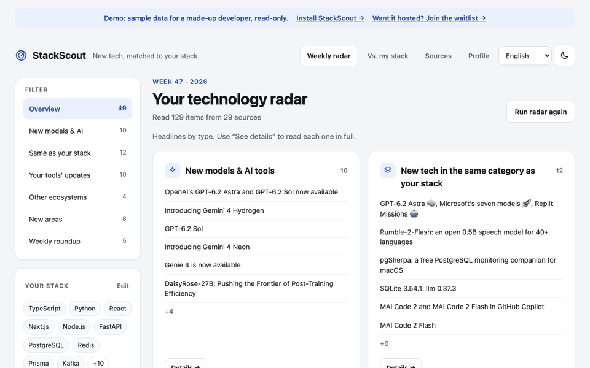
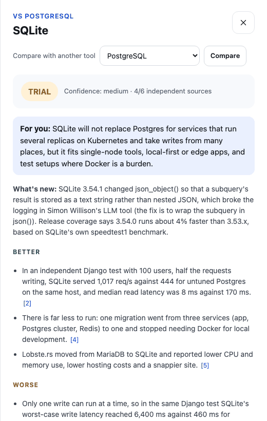
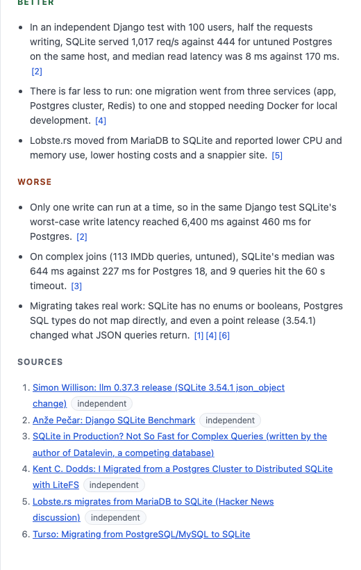
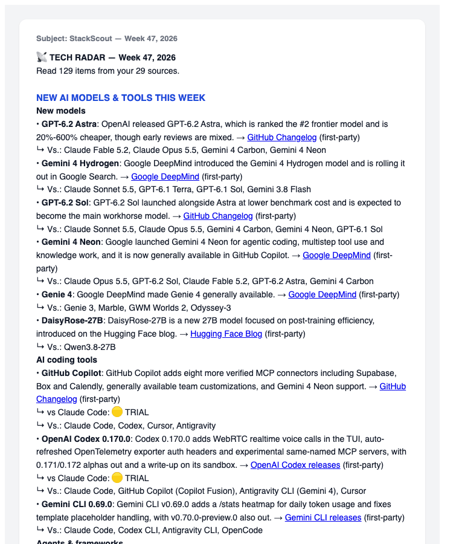
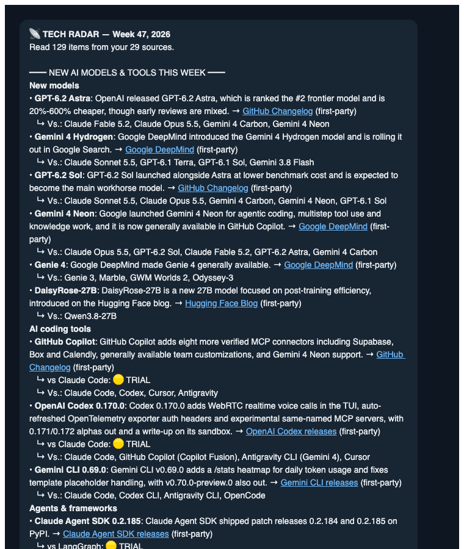
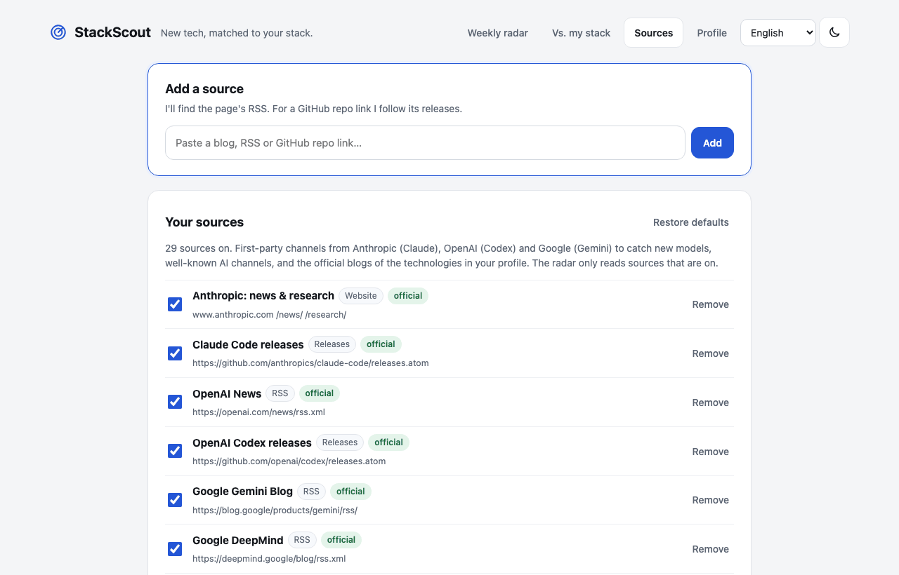
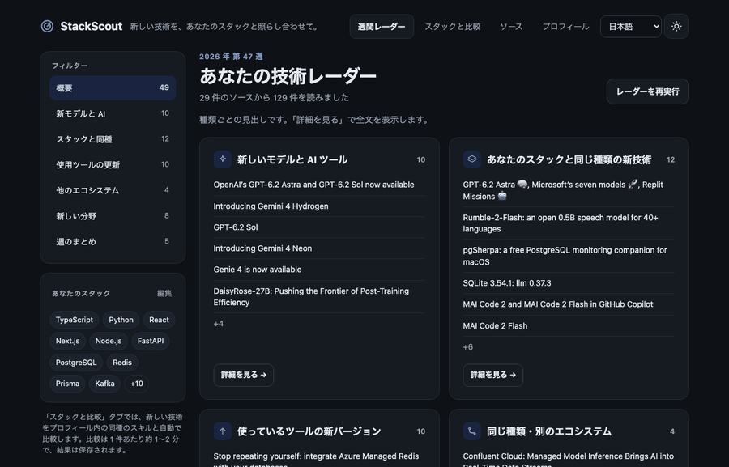
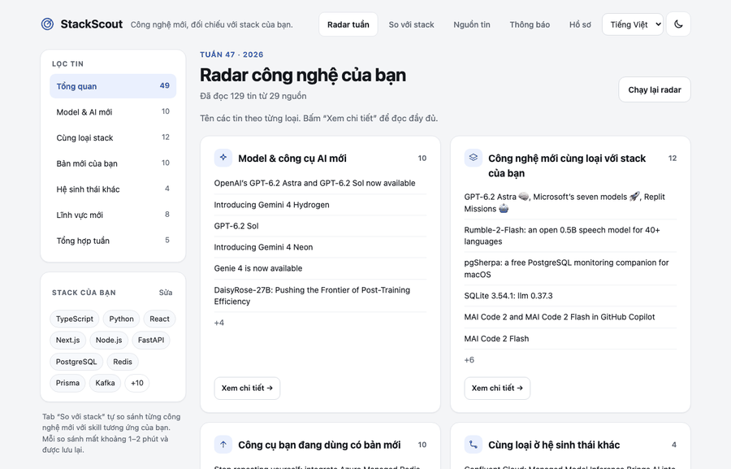
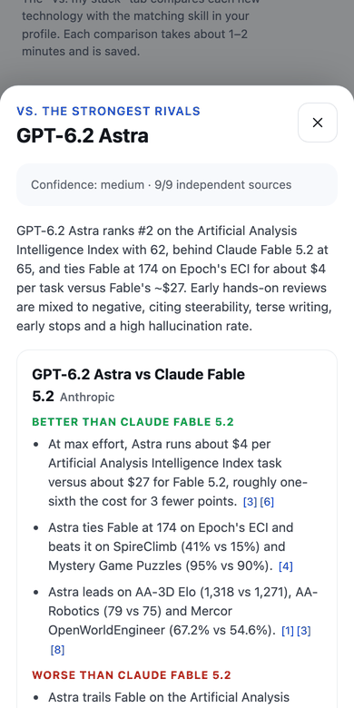

# StackScout (Tiếng Việt)

**Công nghệ mới, đối chiếu với stack của bạn.** · [English](README.md) · [Xem demo](https://huynguyenvietwork.github.io/StackScout/)

StackScout là radar công nghệ hằng tuần: đọc các nguồn chính chủ và uy tín, chọn ra tin liên quan tới **đúng những công cụ bạn đang dùng**, rồi tự so sánh từng công nghệ mới với chúng. Mọi nhận định đều có link nguồn.



## Tính năng chính

### 📡 Cả tuần trong một màn hình

Tiêu đề tin trong tuần được chia theo loại: model và công cụ AI mới, công nghệ cùng loại với stack của bạn, bản mới của công cụ bạn đang dùng, hệ sinh thái khác, lĩnh vực mới và tổng hợp tuần. Bấm **Xem chi tiết** để đọc đầy đủ từng loại.


### 🤖 Model AI mới, so với các đối thủ mạnh nhất

Tin lấy thẳng từ kênh chính chủ (Anthropic, OpenAI, Google DeepMind, Gemini, Hugging Face…). Bấm vào một model là thấy ngay so sánh với **3–5 đối thủ mạnh nhất**: hơn gì, kém gì, nên chọn khi nào. Có số liệu benchmark, giá, và link nguồn cho từng ý.


### 🧩 Tự so sánh với stack của bạn

Mỗi công nghệ mới cùng loại với một công cụ bạn dùng được **tự so sánh** ngay sau khi radar chạy, và chia theo từng skill. Mỗi cái có kết luận: **nên chuyển, thử nghiệm, theo dõi hay bỏ qua**, kèm nhận xét phù hợp với bạn đến đâu. Bấm **⋯** để so với công cụ khác trong hồ sơ.


### 🔗 Nhận định nào cũng có nguồn

Các quy tắc này được kiểm tra bằng code, không phó mặc cho AI:

- ý hơn/kém nào không có link hợp lệ thì bị bỏ;
- dưới 2 nguồn thì ghi *"chưa đủ dữ liệu"*;
- ưu tiên benchmark độc lập và bài trải nghiệm thật, có gắn nhãn; không có nguồn độc lập thì độ tin cậy không được ghi *cao*.

<table>
<tr>
<td width="50%"></td>
<td width="50%"></td>
</tr>
</table>

### 📬 Bản tin gửi tới nơi bạn đọc

Mỗi tuần, theo ngôn ngữ của bạn, qua **Telegram, Email, Slack, Discord** hoặc **webhook** (n8n, Zapier, Make…). Dưới mỗi tin có kết luận so với công cụ của bạn, hoặc danh sách đối thủ của model mới.

<table>
<tr>
<td width="50%"><b>Email</b><br></td>
<td width="50%"><b>Telegram</b><br></td>
</tr>
</table>

### 👤 Hồ sơ gõ tự nhiên, bảo mật từ thiết kế

Cứ gõ những gì bạn dùng, sai chính tả cũng được (*"c#, entity framwork, postgres, k8s"*), hoặc tạo từ code hay CV bằng prompt có sẵn. AI chuẩn hoá tên và mức độ, bạn xác nhận rồi mới lưu. **Chỉ lưu tên công nghệ và mức độ**: không lưu tên dự án, công ty hay bất cứ gì về công việc.


### 📰 Nguồn tin chất lượng, chọn theo stack

Khoảng 60 nguồn đã chọn lọc và kiểm tra còn hoạt động:
- **Kênh AI chính chủ** luôn bật.
- **Blog và trang phát hành chính thức** của công nghệ bạn dùng tự bật theo hồ sơ.
- **Nguồn cộng đồng** (Hacker News, repo GitHub mới nổi…) bật bằng một cú bấm.
- Thêm được bất kỳ blog, RSS hay repo GitHub nào.



### 🌏 5 ngôn ngữ, giao diện sáng/tối, dùng tốt trên điện thoại

Tiếng Việt, English, 中文, 日本語, 한국어 cho cả giao diện, nội dung AI viết, bản tin và bot Telegram.

<table>
<tr>
<td width="40%"></td>
<td width="40%"></td>
<td width="20%"></td>
</tr>
</table>

## Chạy thử

```bash
git clone https://github.com/huynguyenvietwork/StackScout && cd StackScout
cp .env.example .env     # điền ANTHROPIC_API_KEY (hoặc để trống nếu đã đăng nhập Claude Code CLI)
docker compose up -d     # mở http://127.0.0.1:8000
```

Không dùng Docker: `uv sync && uv run main.py web`. Hướng dẫn đầy đủ (kênh thông báo, bot Telegram, lịch gửi) ở [README.md](README.md).

Muốn dùng **bản online không cần cài đặt**? [Đăng ký ở đây](../../issues/new?template=hosted_waitlist.yml), số người đăng ký sẽ quyết định có làm hay không. Góp ý, thêm nguồn tin, thêm ngôn ngữ: xem [CONTRIBUTING.md](CONTRIBUTING.md).
