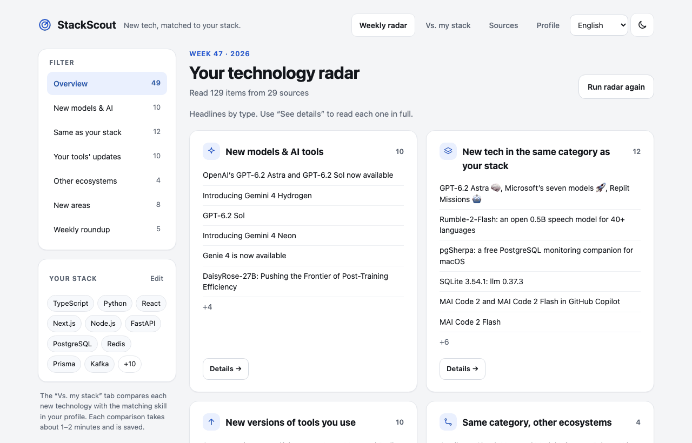
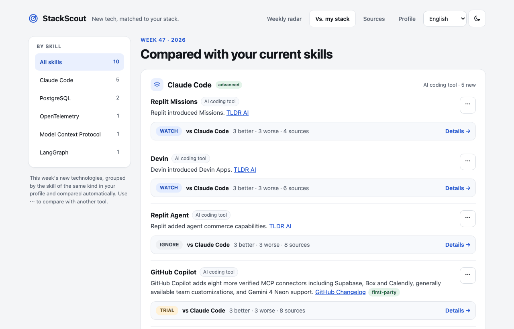
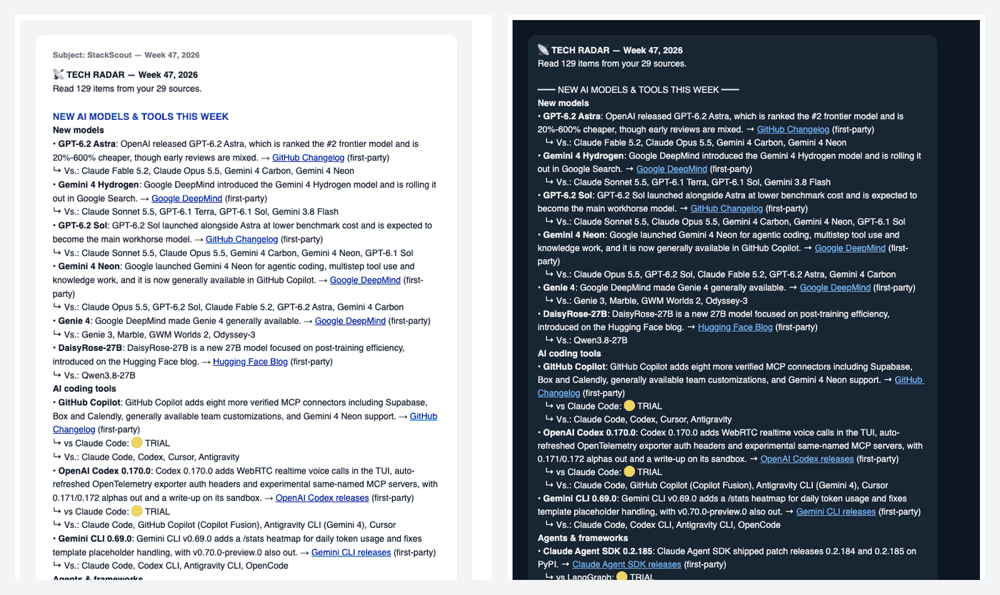
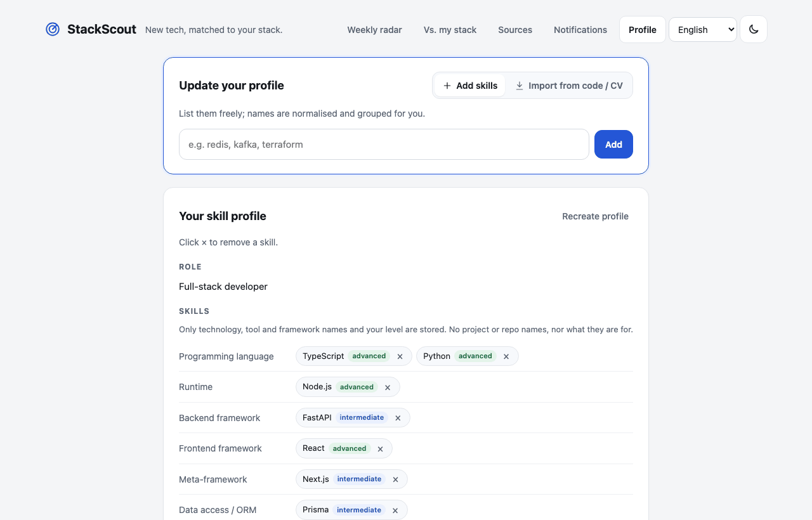

# StackScout (Tiếng Việt)

**Công nghệ mới, đối chiếu với stack của bạn.** · [English](README.md) · [Xem demo](https://huynguyenvietwork.github.io/StackScout/)

StackScout là radar công nghệ hằng tuần: đọc các nguồn chính chủ và uy tín, chọn ra tin liên quan tới **đúng những công cụ bạn đang dùng**, rồi tự so sánh từng công nghệ mới với chúng. Mọi nhận định đều có link nguồn.


## Tính năng chính

<table>
<tr>
<td width="29%" valign="top">

### 📡 Cả tuần trong một màn hình

Tiêu đề tin trong tuần, chia theo ý nghĩa với bạn:

- Model & công cụ AI mới
- Công nghệ mới cùng loại với stack của bạn
- Bản mới của công cụ bạn đang dùng
- Hệ sinh thái khác, lĩnh vực mới, tổng hợp tuần

Bấm **Xem chi tiết** để đọc đầy đủ từng loại.

</td>
<td width="71%" valign="top"><a href="docs/assets/overview.png"></a></td>
</tr>
<tr>
<td width="29%" valign="top">

### 🤖 Model AI mới so với đối thủ mạnh nhất

Tin lấy thẳng từ kênh chính chủ: Anthropic, OpenAI, Google DeepMind, Gemini, Hugging Face…

Bấm vào một model để xem so sánh với **3–5 đối thủ mạnh nhất**, đã tìm sẵn:

- hơn gì, kém gì
- nên chọn cái nào, khi nào
- số liệu benchmark, giá, mỗi ý đều có link

</td>
<td width="71%" valign="top"><a href="docs/assets/rivals.png"></a></td>
</tr>
<tr>
<td width="29%" valign="top">

### 🧩 Tự so sánh với stack của bạn

Ngay sau khi radar chạy, công nghệ mới cùng loại với công cụ bạn dùng được tự so sánh và chia theo từng skill.

- kết luận: **nên chuyển, thử nghiệm, theo dõi hay bỏ qua**
- hơn/kém xem nhanh, chi tiết một cú bấm
- **⋯** để so với công cụ khác trong hồ sơ

</td>
<td width="71%" valign="top"><a href="docs/assets/vs-stack.png"></a></td>
</tr>
<tr>
<td width="29%" valign="top">

### 🔗 Nhận định nào cũng có nguồn

Mỗi so sánh có kết luận và độ tin cậy, nhận xét *với bạn*, điểm mới, tối đa 3 hơn và 3 kém, kèm danh sách nguồn đánh số.

Kiểm tra bằng code, không phó mặc cho AI:

- ý không có link hợp lệ bị bỏ
- dưới 2 nguồn → *"chưa đủ dữ liệu"*
- ưu tiên benchmark độc lập, có gắn nhãn

</td>
<td width="71%" valign="top"><a href="docs/assets/claims.png"></a></td>
</tr>
<tr>
<td width="29%" valign="top">

### 📬 Bản tin gửi tới nơi bạn đọc

Mỗi tuần, đúng ngôn ngữ của bạn, qua:

- **Telegram**
- **Email**
- **Slack** và **Discord**
- **webhook** bất kỳ (n8n, Zapier, Make…)

Dưới mỗi tin: kết luận so với công cụ của bạn, hoặc các đối thủ của model mới.

</td>
<td width="71%" valign="top"><a href="docs/assets/digests.png"></a></td>
</tr>
<tr>
<td width="29%" valign="top">

### 👤 Hồ sơ gõ tự nhiên

Cứ gõ những gì bạn dùng, sai chính tả cũng được (*"c#, entity framwork, postgres, k8s"*), hoặc tạo từ code hay CV bằng prompt có sẵn.

- AI chuẩn hoá tên và mức độ, bạn xác nhận rồi mới lưu
- **bảo mật từ thiết kế**: chỉ lưu tên công nghệ và mức độ, không lưu gì về dự án hay công ty

</td>
<td width="71%" valign="top"><a href="docs/assets/profile.png"></a></td>
</tr>
<tr>
<td width="29%" valign="top">

### 📰 Nguồn tin chất lượng, theo stack

Khoảng 60 nguồn đã chọn lọc và kiểm tra.

- kênh AI chính chủ: luôn bật
- blog và trang phát hành chính thức của công nghệ *bạn dùng*: tự bật
- nguồn cộng đồng (Hacker News, repo GitHub mới nổi…): một cú bấm
- thêm bất kỳ blog, RSS hay repo GitHub nào

</td>
<td width="71%" valign="top"><a href="docs/assets/sources.png"></a></td>
</tr>
<tr>
<td width="29%" valign="top">

### 🌏 5 ngôn ngữ, sáng/tối, trên điện thoại

Tiếng Việt, English, 中文, 日本語, 한국어 cho giao diện, nội dung AI viết, bản tin và bot Telegram.

Có giao diện sáng và tối; trên điện thoại, so sánh mở dạng khung trượt từ dưới lên.

</td>
<td width="71%" valign="top"><a href="docs/assets/looks.png"></a></td>
</tr>
</table>

## Chạy thử

```bash
git clone https://github.com/huynguyenvietwork/StackScout && cd StackScout
cp .env.example .env     # điền ANTHROPIC_API_KEY (hoặc để trống nếu đã đăng nhập Claude Code CLI)
docker compose up -d     # mở http://127.0.0.1:8000
```

Không dùng Docker: `uv sync && uv run main.py web`. Hướng dẫn đầy đủ (kênh thông báo, bot Telegram, lịch gửi) ở [README.md](README.md).

Muốn dùng **bản online không cần cài đặt**? [Đăng ký ở đây](../../issues/new?template=hosted_waitlist.yml), số người đăng ký sẽ quyết định có làm hay không. Góp ý, thêm nguồn tin, thêm ngôn ngữ: xem [CONTRIBUTING.md](CONTRIBUTING.md).
